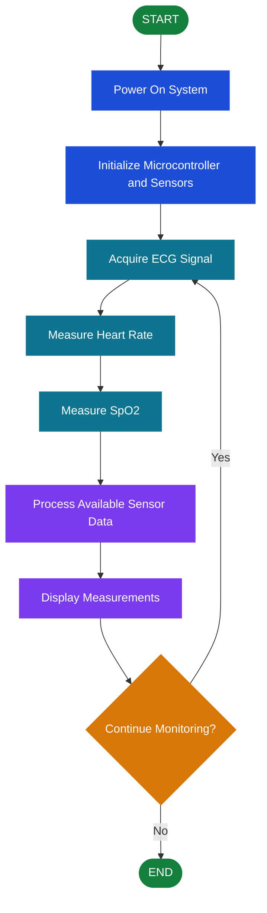

# CardioVascular-Monitoring-System
Embedded Prototype

# ❤️ CardioVascular Monitoring System
### Embedded Health Monitoring

  
  

  <strong>Monitoring Vital Signs Through Embedded Systems</strong>

## 📌 Project Description

The **CardioVascular Monitoring System** is an electronics prototype exploring the measurement and monitoring of cardiovascular-related parameters using sensors and a microcontroller.

The system focuses on three key measurements: **electrocardiogram (ECG), heart rate, and blood oxygen saturation (SpO₂)**. By integrating electronic sensors with an embedded controller, the prototype explores how physiological signals can be collected and presented for observation.

This project demonstrates the application of embedded systems, sensor integration, and biomedical electronics in health-monitoring technology.

> **Disclaimer:** This is an educational prototype, not a certified medical device. Its readings should not be used to diagnose conditions or replace professional medical evaluation.

## 🎯 Objectives

- Explore ECG signal acquisition using an ECG sensor.
- Measure heart rate using an appropriate heart-rate sensor.
- Explore blood oxygen saturation (SpO₂) measurement using a compatible sensor.
- Integrate sensors with a microcontroller.
- Display or process collected measurements, if supported by the prototype.
- Demonstrate the use of embedded systems in biomedical electronics.

## ✨ Main Features

- ❤️ **ECG Monitoring** — Captures electrical signals associated with heart activity, if an ECG module is implemented.
- 💓 **Heart-Rate Monitoring** — Measures heart rate using a compatible sensor.
- 🩸 **SpO₂ Monitoring** — Estimates blood oxygen saturation using a compatible optical sensor.
- ⚙️ **Embedded Processing** — Uses a microcontroller to read and process sensor data.
- 📊 **Data Display** — Presents measurements through a display or connected interface, if implemented.

*Retain only the features that are actually working in your prototype.*

## 🔄 System Workflow

1. **Power On** — Turn on the monitoring prototype.
2. **Initialize the System** — The microcontroller initializes the connected sensors.
3. **Collect Sensor Data** — The sensors acquire ECG signals, heart-rate data, and SpO₂ readings, depending on the installed hardware.
4. **Process Measurements** — The microcontroller processes or receives the sensor readings.
5. **Display Results** — Available measurements are shown on a display or other supported output.
6. **Continue Monitoring** — The system repeats the measurement process while operating.

## 📊 System Flowchart

*This is a general workflow. Adjust the steps to match the sensors and functions actually implemented.*

## 🧰 Materials and Components

The following components are common options for this type of prototype. Confirm them against your actual hardware before publishing.

| Component | Purpose |
|---|---|
| Microcontroller (e.g., Arduino or ESP32) | Reads sensor data and coordinates system operation |
| ECG sensor/module | Acquires electrical signals associated with heart activity |
| Pulse oximeter sensor/module | Estimates SpO₂ and may provide heart-rate readings |
| Display module (e.g., OLED or LCD) | Shows measurements, if included |
| Breadboard or PCB | Supports circuit assembly |
| Jumper wires | Connects the electronic components |
| Power source | Powers the controller and sensors |
| Resistors and other passive components | Supports circuit requirements, if needed |
| Enclosure or prototype base | Holds and protects the assembled components |

**Note:** This is a suggested materials list, not a verified inventory of your project. A pulse oximeter module may already provide heart-rate data, so a separate heart-rate sensor may not be necessary.

## 💻 Programming Languages and Technologies

The exact programming language depends on the microcontroller and development environment used.

### Example: Arduino-Based Prototype

  
  

  <strong>Arduino IDE</strong> &nbsp; | &nbsp; <strong>Arduino C/C++</strong>

- **Arduino C/C++** — Can be used to read sensor data, process measurements, and control the display.
- **Arduino IDE** — Can be used to write, compile, and upload the program to a compatible microcontroller.

### Other Possible Technologies

- **ESP32** — An alternative microcontroller platform.
- **MicroPython** — A possible programming option on compatible microcontrollers.
- **Python** — May be used for a separate computer-based interface or data analysis.

*The logos above are examples. Keep only the languages and platforms you actually used.*

## ⚙️ How It Works

The prototype connects physiological sensors to an embedded controller. The ECG module acquires electrical activity signals, while a compatible pulse oximeter estimates blood oxygen saturation and can also measure pulse rate. The microcontroller reads the available data and may process or display the results, depending on the implemented software and hardware.

The accuracy of the readings depends on the sensor, circuit design, signal processing, calibration, and measurement conditions.

## 🚀 Potential Improvements

- Improve ECG signal visualization and noise reduction.
- Add clear measurement units and sensor status indicators.
- Store readings for later review, if supported.
- Improve wiring, enclosure, and electrical safety.
- Add sensor-disconnection detection.
- Validate measurements against suitable reference equipment.
- Document the limitations and testing results of the prototype.

## 👨‍💻 Project Information

- **Project Title:** CardioVascular Monitoring System
- **Project Focus:** Embedded Health Monitoring
- **Project Category:** Biomedical Electronics / Embedded Systems
- **Developer:** [Your Name]
- **Development Year:** [Your Project Year]
- **Microcontroller:** [Your Actual Board]
- **Programming Language:** [Your Actual Language]
- **Sensors:** [Your Actual Sensor Modules]

---

  <strong>❤️ Embedded Systems for Health-Monitoring Innovation</strong> 
  <em>Learning through electronics, sensing, and prototyping.</em>

